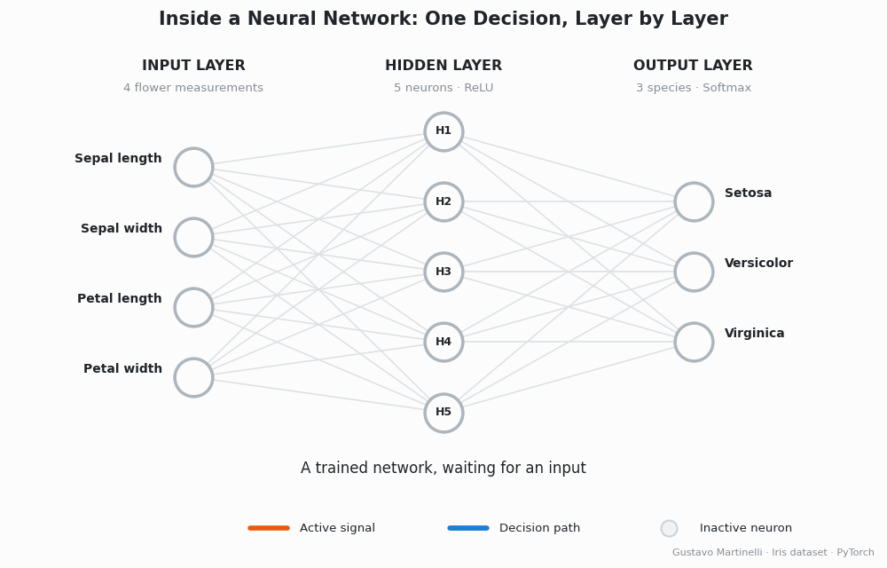

# 🏛️ AI Governance Lab
 
**Hands-on Colab notebooks bridging AI engineering and AI governance: explainability, transparency and responsible AI, one LinkedIn post at a time.**

[](https://github.com/gustavomartinellidev/ai-governance-lab)
[](https://github.com/gustavomartinellidev)
[](https://www.linkedin.com/in/gustavomartinelli/)
 
Each notebook starts from working code and ends with the governance questions that code raises. *Why did the model decide this? Can the result be reproduced? Can a non-technical reviewer understand it?* Everything runs in Google Colab in a few minutes, with no installation and no GPU.
 
<p align="center">
  
</p>

## 📚 Notebooks
 
| # | Title | Topic | Notebook | Post |
|---|---|---|---|---|
| 001 | [Inside a Neural Network: One Decision, Layer by Layer](notebooks/001-inside-a-neural-network/) | Explainability (XAI) | [](https://colab.research.google.com/github/gustavomartinellidev/ai-governance-lab/blob/main/notebooks/001-inside-a-neural-network/inside-a-neural-network.ipynb) | [LinkedIn](LINKEDIN_POST_URL) |
 
*New notebooks are added as new posts are published.*
 
## 🧭 Principles
 
Every notebook in this repository follows the same approach:
 
| Principle | In practice |
|---|---|
| **Reproducible** | Fixed random seeds, public datasets and a model fingerprint, so results can be verified |
| **Explained step by step** | A short explanation before every code cell, plus a 🏛️ governance note |
| **Readable by non-technical audiences** | Results translated into plain-language reports and visuals |
| **Honest about limits** | Each notebook states what its method does *not* cover |
| **Grounded in regulation and standards** | References to LGPD, EU AI Act, GDPR, ISO/IEC 42001 and NIST AI RMF where relevant |
 
## ▶️ How to use
 
1. Pick a notebook from the table and click **Open in Colab**.
2. Select `Runtime → Run all`.
3. Read the explanations, change the parameters and run again.
Each notebook folder has its own README with a summary, results and outputs (GIFs, PDF reports).
 
## 📁 Repository structure
 
```
ai-governance-lab/
├── README.md                  ← this page
├── LICENSE
├── assets/                    ← shared images
└── notebooks/
    └── 001-inside-a-neural-network/
        ├── README.md          ← summary, results and how to run
        ├── inside-a-neural-network.ipynb
        ├── decision_path.gif
        └── explainability_report.pdf
```
 
## 👤 About the author

<table>
<tr>
<td width="130" valign="top">

</td>
<td valign="top">
<b>Gustavo Martinelli</b><br>
AI Engineer &amp; AI Governance Specialist<br><br>
Computer Science and Law backgrounds, working at the intersection of AI engineering, AI governance and information security.<br><br>
<a href="https://www.linkedin.com/in/gustavomartinelli/">💼 LinkedIn</a> · <a href="https://aiknowledgemap.org">🗺️ AI Knowledge Map</a>
</td>
</tr>
</table>

## 📄 License and disclaimer
 
The code is released under the **MIT License** (see [`LICENSE`](LICENSE)). Feel free to copy, adapt and share it, with attribution.
 
The notebooks are **educational material and do not constitute legal advice**.

## ⭐ Support this project

If these notebooks are useful to you:
- **Star this repository**: it helps more people find it.
- **Follow me** on [GitHub](https://github.com/gustavomartinellidev) and [LinkedIn](https://www.linkedin.com/in/gustavomartinelli/) for new notebooks.
- **Share** a notebook with someone working on AI or AI governance.
