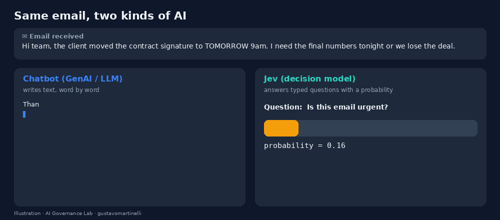

# 🎯 Jev for Everyone: an AI that answers with numbers, not words

> *"If the answer is a decision, use Jev. If the answer is a text, use a chatbot."*

A beginner-friendly, hands-on guide to **Jev**, the decision model from TypeSafe AI, written for **everyone**, not only developers. Every step is explained in plain language; every piece of code is short and commented.

## What's inside

| Block | Section | What you learn |
|---|---|---|
| **1. Understand** | What is Jev? | Decision model vs. chatbot, the three question types (Noul, Choice, Score), when to use it and when not to |
| | Setup and your API key | Disclaimer, creating a key, storing it in Colab Secrets (illustrated), installing the SDK, pinning the model version, first call |
| **2. Try** | Example 1: Inbox triage | Urgent? Phishing? Which category? Then a rule that sorts the inbox |
| | Example 2: Customer feedback | Satisfaction on a 0–4 scale, topic, refund request, a chart and a to-do list |
| | Example 3: Safe to send to the AI? | Jev as a guardrail in front of a chatbot: personal data, manipulation, off-topic |
| **3. Reflect** | What did we gain? | Measured latency and cost, side-by-side with common GenAI |
| | Takeaways, limitations, going further | What to remember, what to be careful about, what to try next |

## How to run

1. Open the notebook in Colab (badge above). You can **read everything without running anything**: outputs are saved.
2. To run it, create a TypeSafe API key (Section 2.2) and store it in Colab **Secrets** as `TYPESAFE_API_KEY` with notebook access on (Section 2.3).
3. `Runtime → Run all`. About 20 API calls, under a minute, no GPU, a fraction of a cent.

> ⚠️ The key is **not included** and the author cannot provide one. Jev is in early access at the time of writing; availability, prices and limits may change. Calls are billed to your own account.

## Files

| File | Description |
|---|---|
| `jev_for_everyone.ipynb` | The notebook, with saved outputs |
| `assets/chatbot_vs_jev.gif` | Animation: the same email answered by a chatbot and by Jev |
| `assets/three_question_types.png` | Noul / Choice / Score at a glance |
| `assets/step1_typesafe_api_key.png` | Illustration: creating the key in the TypeSafe console |
| `assets/step2_colab_secrets.png` | Illustration: storing the key in Colab Secrets |
| `feedback_by_topic.png` | Chart produced by Example 2 |

The two "step" images are **illustrations**, not real screenshots; the real pages may look different.

## Governance angle

- **ISO/IEC 27001** A.5.17 (authentication information), A.8.15 (logging)
- **ISO/IEC 42001** A.6.2.6 (operation and monitoring), A.8.2 (documentation), A.9.2–A.9.4 (human oversight)
- **NIST AI RMF** MEASURE and MANAGE
- **EU AI Act** Art. 12 (record-keeping), Art. 14 (human oversight)
- **GDPR / LGPD** data minimization

Typed outputs make decisions loggable, comparable and auditable; thresholds in code make human oversight a mechanism rather than a promise.

## Limitations

- The model can be wrong, including when confident; validate thresholds on your own data.
- All emails, reviews and messages are synthetic.
- Sending real data to an external API is itself a decision; check your policies first.
- Educational material, **not legal advice**; independent work, not affiliated with TypeSafe AI.

---

**Gustavo Martinelli** · AI Engineer &amp; AI Governance Specialist · [LinkedIn](https://www.linkedin.com/in/gustavomartinelli/)

*Part of [AI Governance Lab](../../README.md). Feel free to copy, adapt and share, with attribution.*

## ⭐ Support this project

If these notebooks are useful to you:
- **Star this repository**: it helps more people find it.
- **Follow me** on [GitHub](https://github.com/gustavomartinellidev) and [LinkedIn](https://www.linkedin.com/in/gustavomartinelli/) for new notebooks.
- **Share** a notebook with someone working on AI or AI governance.
